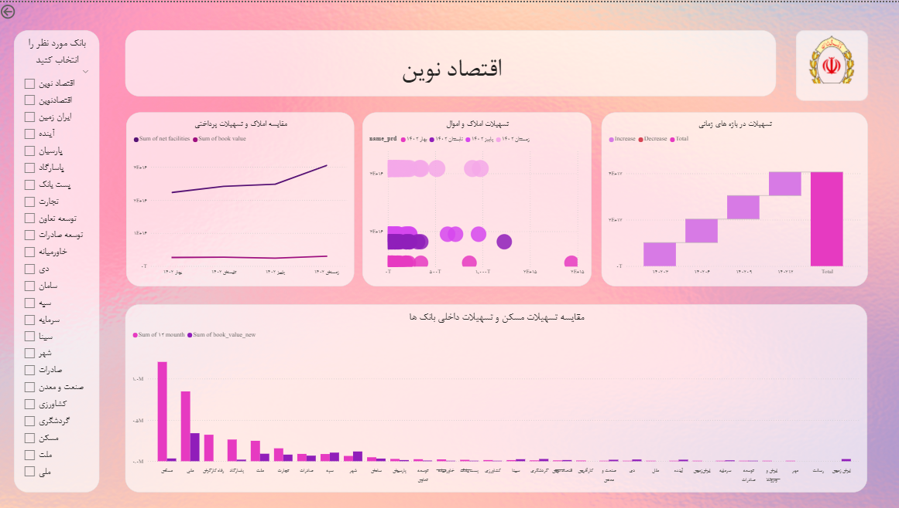
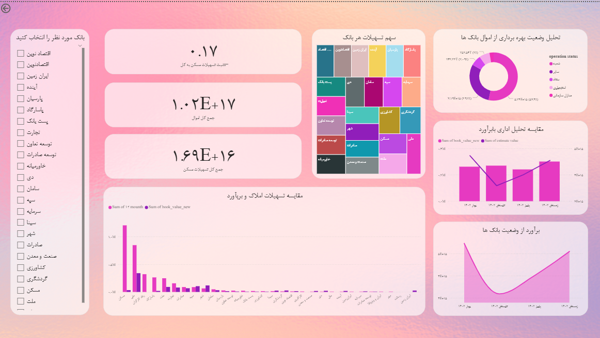
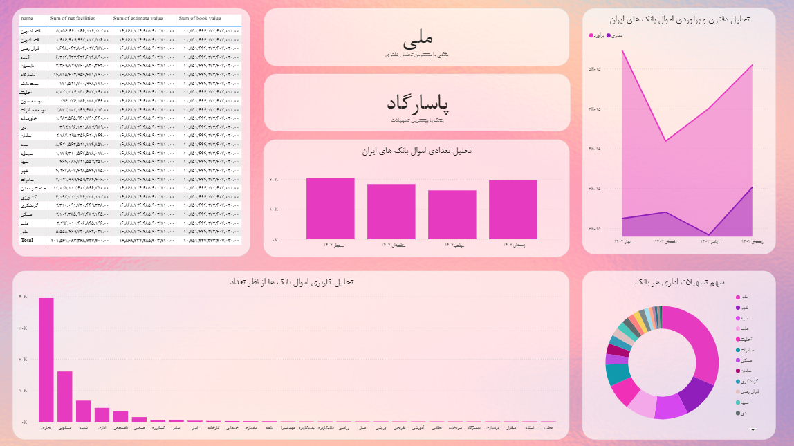

# Iranian Banking Sector Analytics Dashboard

An interactive Power BI dashboard developed to explore and compare selected financial indicators across Iranian banks using synthetic educational data.

## Important Note: Synthetic Data

**This project uses synthetic data generated by the course instructor solely for educational purposes.** The dataset does not contain actual financial records or verified financial information about the banks represented in the dashboard.

All figures, financial indicators, trends, and comparisons are illustrative and must not be interpreted as reflecting the real financial performance or condition of any bank.

## Project Overview

This project was developed independently as part of the Power BI Dashboard Design course at Tehran Institute of Technology.

The dashboard provides interactive visualizations of selected banking indicators, including assets, lending activities, book values, and estimated values. Users can filter by bank and explore comparisons across reporting periods.

## Key Features

- Interactive bank selection and filtering
- Comparison of selected banking assets and lending indicators
- Analysis of book values and estimated values
- Visual exploration of financial indicators over time
- Bar charts, line charts, waterfall charts, treemaps, and donut charts

## Tools and Technologies

- Microsoft Power BI Desktop
- DAX
- Power Query
- Interactive data visualization

## Dashboard Screenshots

### Banking Overview

### Bank Comparison

### Financial Trends

## Project File

The original Power BI report is available in this repository:

[Download Power BI Project](maral_esmikhani_project_1.pbix)

**Language note:** The dashboard interface is currently in Persian (Farsi). This README provides an English description for international readers.

## Data Source

The dataset was synthetically generated and provided by the course instructor at Tehran Institute of Technology for an educational Power BI project. It is not sourced from actual bank financial statements or official banking databases.

## Author

**Maral Esmikhani**  
B.Sc. Student in Industrial Engineering  
Shahid Beheshti University
